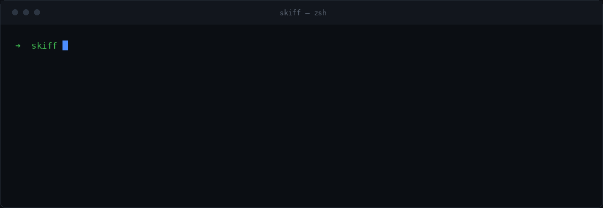
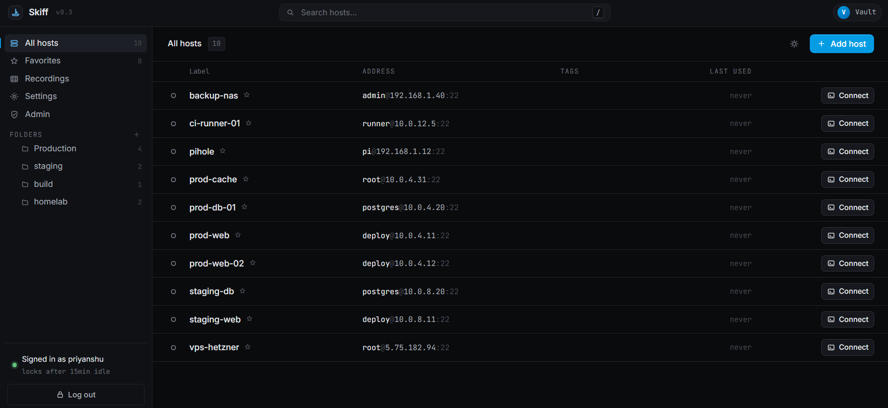
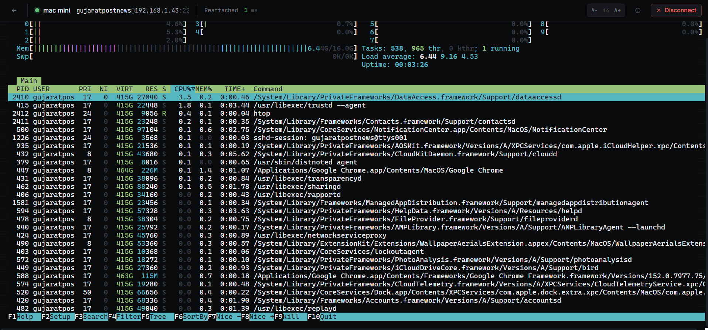

<div align="center">



<br><br>

[](https://github.com/Priyanshu-1622/skiff/actions/workflows/ci.yml)
[](https://github.com/Priyanshu-1622/skiff/releases)
[](./LICENSE)
[](https://nodejs.org)
[](#docker)
[](#what-makes-it-different)
[](https://github.com/Priyanshu-1622/skiff/commits/main)
[](https://github.com/Priyanshu-1622/skiff/stargazers)

<br>

**[Website](https://skiffssh.me)** · [Memory](#memory-find-the-fix-you-used-last-time) · [Quick start](#quick-start) · [Desktop edition](#prefer-a-desktop-app) · [Security model](#security-model--the-short-version) · [What it doesn't do](#what-skiff-doesnt-do)

</div>

<br>

**A self-hosted SSH manager with a memory. An open-source alternative to Termius.**

**What changed on this server? How did I fix this last time?** Skiff gives your
SSH work a searchable memory: commands and their output, before-and-after file
diffs, and notes tied to each host. Nothing to install on your target servers.

It's a self-hosted SSH manager with a real in-browser terminal and an encrypted
credential vault. Sessions live in the Skiff server process, so a closed tab or
dropped Wi-Fi doesn't immediately end your work. Reattach with recent scrollback,
within the session's idle grace period. No tmux required.

Run it with Docker **or directly with Node.js**. SQLite, no external database,
no cloud account, no telemetry. Optional team accounts and session recording
are included in this web edition.



## Memory: find the fix you used last time

Open a host's **History** from the terminal, or search across hosts on the
**Memory** page. Expand a command to see its captured output, search output too,
filter failed commands, and find the work that led to a fix.

- **See the change, not just the command.** For supported edits to small text
  files, Skiff reads the file over SFTP and keeps the diff and both versions.
  Inspect the full file or copy the old version; there's no automatic restore.
- **Keep useful work close to the host.** Pin an entry to its notes, save a
  command as a snippet, or use Run again to put it in the terminal. You review
  it and press Enter yourself.
- **Notice changes between visits.** Tracked-file checks at reconnect can flag
  changes made outside Skiff. Optional server snapshots check selected server
  state at connect; they aren't continuous monitoring.
- **Choose what to remember.** Pause capture, turn Memory off per host or for
  the vault, forget individual entries, and set output retention. Remembered
  content is encrypted; search indexes stay in memory while you're unlocked.

Memory is best-effort. Full-screen apps are marked rather than recorded as
command output, and secret redaction can miss things. Pasted multiline scripts
are one **multi-line block**, preserving their commands and combined output;
when available, the exit status belongs to the whole submission. Precise mode
adds shell integration for exact commands and exit codes. See
[the limitations](#known-issues--rough-edges) and [Memory's storage model](SECURITY.md#memory).

## How it works



Your browser is a viewer, not the session. It attaches over a websocket and
detaches when you close it — the SSH connection stays open in the Skiff process
on your server, holding scrollback, until you come back or the idle timer reaps
it. Nothing is installed on the target hosts to make that work.

## Quick start



### Docker

```bash
git clone https://github.com/Priyanshu-1622/skiff.git
cd skiff
cp .env.example .env
# Generate with: openssl rand -hex 32
# Paste the generated value into SKIFF_COOKIE_SECRET in .env

# Create the data directory as your own user BEFORE starting.
# If you skip this, Docker creates it as root and the container
# (which runs as the unprivileged node user) can't write the database.
mkdir -p data

docker compose up -d --build
```

Open http://localhost:8080. Before creating the first vault, copy the **setup
token** from your server logs:

```bash
docker compose logs skiff | grep "Setup token"
```

In PowerShell, use `docker compose logs skiff | Select-String "Setup token"`.
Enter the token on the setup screen, then choose personal or team mode and
create your master password or first admin login.

Back up `./data/` — that's where the encrypted vault lives.

By default it binds to `127.0.0.1` only, so it isn't reachable from the network
before you've set a master password. Set `HOST_ADDR=0.0.0.0` in `.env` and put
it behind a reverse proxy with TLS when you're ready to expose it.

### Run without Docker

Docker is optional. Install **Node.js 20+** and **pnpm 9+**, then run from source:

```bash
git clone https://github.com/Priyanshu-1622/skiff.git
cd skiff
pnpm install
pnpm --filter @skiff/shared build
pnpm dev
```

Keep that terminal running and open http://localhost:5173. The API runs on
localhost:8080; Vite serves the UI on localhost:5173 and proxies API requests.
Copy the **setup token** from the API output in the terminal running `pnpm dev`,
then choose personal or team mode and create your password on the setup screen.

The shared-package build is required on a clean clone. Use `pnpm`, rather than
`npm run dev`, for this workspace. On Windows, native modules may need Visual
Studio Build Tools; see [Troubleshooting](#troubleshooting).

With these source-development commands, the default data directory is
`apps/api/data/`. Back it up and keep it between runs. Set `SKIFF_DATA_DIR` to
an absolute path if you want to choose the same vault location for every method.

For a built deployment without the Vite development server, run `pnpm build`,
set `NODE_ENV=production` and a random `SKIFF_COOKIE_SECRET` of at least 32
characters in your process environment, then run `node apps/api/dist/server.js`
from the repository root. It serves the built UI at http://localhost:8080.
See [deployment guidance](docs/DEPLOYMENT.md) before exposing either method.
When started from the root this way, the default data directory is `./data/`.
Direct runs read configuration from process environment variables; copying
`.env.example` alone doesn't load them as it does with Docker Compose.

### First-run setup token — both methods

The generated log message looks like this (example only):

```text
Vault not initialized. Setup token: 7d91c0386b2fa450e83d1947ac6205bf  (enter it on the setup screen; it changes on every restart until setup is done)
```

Use the value from **your own running server**. The token proves you operate
the fresh instance; it isn't an invitation code, an SSH password, or something
you obtain from Skiff's website. It is needed only to initialize a vault or
restore into a fresh instance, not whenever a team member gets an account.

Until setup is complete, a generated token changes whenever the API restarts.
If your token is rejected after a restart, copy the latest one. Once the vault
exists, unlock it with your password; you don't need the setup token again.

For automated deployments, `SKIFF_SETUP_TOKEN` can pin your own token. In that
case the log says to use the configured value instead of printing it. A value
such as `skiff-manual-test-20261009` is a token chosen for a local test instance,
not a universal Skiff token. Leave this variable unset for normal interactive
setup and use the generated token.

## Why I built this

I had a text file called `servers.md` with a growing list of SSH commands I
kept copy-pasting into my terminal. Every time I added a new VPS or rotated a
key I'd promise myself I'd "set up a proper tool", then I'd open Termius, see
the sign-in screen, and close it again. I didn't want my SSH inventory in
someone else's cloud — and the desktop alternatives are either paid or feel
like they were designed in 2011.

So one weekend I figured how hard could it really be: encrypted SQLite + ssh2 +
xterm.js. A couple of weeks later I had something I actually use every day.
It's not finished — see "Known issues" for the rough edges — but it scratches
the itch.

The session persistence came later, and for a stupid reason: I kept losing
long-running work when my laptop slept. A browser terminal that drops your
session on every disconnect is worse than `ssh` in a terminal, not better. So
the session moved to the server.

## What makes it different

Most self-hosted SSH managers are a nicer list of hosts. These are the parts
that aren't:

**A memory of the work, attached to the server.** Search commands and captured
output across hosts, inspect file diffs and prior versions, and keep host notes
and reusable snippets beside the terminal. Memory helps you retrace a fix
without replaying an entire terminal recording or writing a runbook from scratch.
It uses the existing SSH/SFTP connection, with no agent on the target host.

**Sessions survive the browser.** The SSH connection lives in the server
process. Closing the tab, sleeping the laptop, or switching machines doesn't
kill it — reopening the host reattaches you, with recent scrollback replayed.
Idle sessions get cleaned up on a timer. Nothing is installed on the target
host to make this work; no tmux, no screen, no agent.

**Sessions are recordable.** Optionally record any terminal session to disk in
the open [asciicast](https://docs.asciinema.org/manual/asciicast/v2/) format
and replay it in the browser afterwards. On by default in team mode so admins
can review what was actually done, off by default for personal use.

**Team mode is one vault, many people.** A single shared encryption key, with
each member holding their own copy sealed to their own password. Everyone can
reach the hosts; every action is attributed to a specific person in the audit
log. No external identity provider, no cloud.

**It's actually self-hosted.** One `docker compose` command, SQLite, no
external database. Your credentials never leave your machine and there is no
telemetry. The web UI makes no third-party requests at all — fonts and the
recordings player are bundled — so it works on an air-gapped network, and a
strict Content-Security-Policy enforces that nothing else gets loaded.

## How it compares

| | **Skiff** | Termius | Royal TSX | SecureCRT |
|---|---|---|---|---|
| Session survives disconnect | **yes, server-side** | no | no | no |
| Session recording + replay | **built in** | paid tier | no | scripted only |
| Self-hosted | **yes** | no | no | no |
| Open source | **yes** | no | no | no |
| Price | **free** | freemium ($) | paid ($45+) | paid ($99+) |
| In-browser terminal | **yes** | no (native app) | no | no |
| Cloud sync | no cloud service; access your own server | required for sync | local only | local only |
| Telemetry | **none** | yes | unknown | unknown |
| Encryption at rest | yes | yes | yes | yes |
| Team features | yes (self-hosted) | yes (paid) | yes | yes |
| Docker deploy | one command | n/a | n/a | n/a |

Skiff is for people who want to own their SSH inventory. If you need a polished
mobile app or enterprise SSO today, Termius and Teleport are still ahead. Skiff
is for the case where you specifically don't want your servers' credentials
living in someone else's cloud — and you're tired of losing a session because a
tab closed.

## Prefer a desktop app?

There's now a native desktop build — same engine, nothing to deploy. It adds
SFTP file transfer, port forwarding and tunnels, jump hosts, and a
hash-chained audit log you can verify in-app, none of which the server build
has yet.

The Memory workflows described above belong to **this webapp edition**. Don't
assume desktop and web feature parity; check the desktop repository for its
current feature set.

**[Download for Windows and Linux → skiffssh.me](https://skiffssh.me/download.html)**

macOS builds exist but aren't signed yet, so they're not published — see the
download page for why.

Source: [Priyanshu-1622/skiff-app](https://github.com/Priyanshu-1622/skiff-app), also AGPL-3.0.

The server build in this repo is still maintained. Use it when you want the
vault reachable from a browser, from more than one machine, or shared with a
team. Use the desktop app when it's just you on one machine.

### Screenshots



<br>

#### The session that outlived its tab



<sub>Look at the header: <b>Reattached</b>. That session was opened in a
different browser and the tab was closed — this is the same process on the
same host, picked back up where it was.</sub>

## Features

- **Persistent sessions.** Your SSH session lives on the server, not in the
  browser tab. Close the tab, lose your wifi, switch devices — reopen the host
  and you're reattached exactly where you left off, with recent scrollback
  replayed. Idle sessions are cleaned up automatically. No tmux required on the
  target host.
- **Session recording & playback.** Optionally record every terminal session to
  disk in the open [asciicast](https://docs.asciinema.org/manual/asciicast/v2/)
  format and replay it later from the Recordings page. On by default in team
  mode (admins can review any member's sessions), off by default for personal
  use. Toggle it in Settings.
- **Memory.** Skiff remembers what happened on your servers, with nothing
  installed on them. Captured commands from a Skiff session are saved
  (encrypted) with its output, searchable per host from the terminal's History
  drawer and across all hosts from the Memory page. When a command edits a
  file (an editor, `sed -i`, `tee`, a redirect, `cp`/`mv`), Skiff reads the file
  over SFTP before and after and keeps the diff plus both versions. Optional
  extras, each switched on per host: **Precise mode** (exact commands and exit
  codes for bash, zsh and fish), and **Server snapshots** (a short read-only
  check at connect that flags changes nobody made through Skiff). Each host
  also gets a living **note** (Pin any entry to it) and there is a **snippet**
  library (Run types a command into the terminal; you press Enter). You can
  pause Memory in a session, turn it off per host or for the whole vault, and
  Forget any entry. See [SECURITY.md](SECURITY.md#memory) for exactly what is
  stored and how.
- **Encrypted credential vault.** AES-256-GCM at rest, key derived from your
  master password with argon2id (OWASP params). The key lives in memory while
  you're unlocked and gets zeroed on lock or idle timeout. The password itself
  is never stored — only an HMAC verifier so we can tell you "wrong password"
  without having to decrypt anything.
- **In-browser terminal.** xterm.js over a WebSocket. Real SSH session, no fake
  shell.
- **Team mode (optional).** Run the vault for a group instead of one person.
  Multiple user accounts, each with their own login, sharing one encrypted
  vault. Admins add members, reset passwords, and disable accounts; every
  privileged action — logins, connections, host changes — is recorded in an
  audit log. A personal vault can be upgraded to a team vault in place without
  touching your existing hosts. Fully self-hosted; no cloud, no external
  identity provider.
- Folders, favorites, search. Search hits labels, hostnames, and usernames.
- Imports your `~/.ssh/config`. Parses `Host`, `HostName`, `Port`, `User`,
  `IdentityFile`. Doesn't handle `Include` directives yet (see Known issues).
- SSH host fingerprint pinning. First connect saves it; mismatches block the
  connection.
- Auto-lock on idle. Configurable, defaults to 15 minutes.
- Dark / light themes.
- Single `docker compose` command to deploy. SQLite, so no separate database to
  run.

## Team mode

By default Skiff is a personal vault: one master password, one user. If you're running it for a group, you can use **team mode** instead.

In team mode there's still exactly one encrypted vault, but multiple people have their own accounts to unlock it:

- **Per-user logins.** Each member signs in with a username and their own password. Behind the scenes the vault has a single shared encryption key; each user keeps their own copy of it, sealed with a key derived from their password. Any member can decrypt the shared hosts, but every session is tied to a specific user.
- **Admins.** Admins can add members, reset a member's password, and disable accounts. The first admin is created at setup (or during the personal → team upgrade). Skiff won't let you disable the last remaining admin.
- **Audit log.** Logins, failed logins, host connections (who connected to which host, as which SSH user), and host/user changes are all recorded. Admins review it from the Admin panel.
- **Forgot-password recovery.** Because there's no cloud, a forgotten password can't be auto-recovered — but an admin can issue a new temporary password. No data is lost, because credentials are encrypted with the shared vault key, not any individual's password.

Choose the mode at first-run setup, or upgrade an existing personal vault from **Settings → Team**. The upgrade keeps all your hosts and credentials exactly as they are — your existing vault key simply becomes the shared key, so nothing is re-encrypted. The upgrade is one-way.

What team mode is **not**: it's not full role-based access control. Every member can see and connect to every host in the shared vault — there are no per-host or per-folder permissions, and no read-only role. If you need granular RBAC for a larger organization, that's out of scope for the open-source project.

<details>
<summary><b>Project structure</b></summary>


```
skiff/
├── apps/
│   ├── web/                    React frontend (Vite)
│   │   ├── src/
│   │   │   ├── components/     Shell (Topbar, Sidebar, AppShell), icons
│   │   │   ├── routes/         unlock, setup, dashboard, terminal, memory, recordings, settings, team
│   │   │   ├── lib/            API client, vault store, theme, ws client
│   │   │   └── styles/         Design tokens + per-screen CSS
│   │   └── vite.config.ts
│   └── api/                    Fastify backend
│       ├── src/
│       │   ├── crypto/         AES-256-GCM + argon2id, session store, team-vault (shared-key sealing)
│       │   ├── routes/         auth, hosts, terminal, memory, notes, recordings, import, settings, team
│       │   ├── db/             SQLite schema + connection + migrations
│       │   └── lib/            auth middleware, audit log, response helpers, id gen
│       └── server.ts
├── packages/
│   └── shared/                 Types shared between web and api
├── docs/                       Diagram, deploy gif, screenshots
├── Dockerfile                  Multi-stage production build
├── docker-compose.yml          One-command production deploy
└── .env.example                All configurable env vars
```

It's a pnpm workspace with two apps and one shared types package. The frontend and backend are decoupled — the web app talks to the API over HTTP + WebSocket, no direct imports between them.

</details>

## Known issues / rough edges

These are real things I've noticed using Skiff. Some are easy fixes I haven't gotten to; some need a redesign.

- **Import doesn't follow `Include` directives**, and skips `Match` blocks and wildcard `Host` patterns (they don't describe a single host). Paste included files separately. Imported hosts have no password or key yet — `~/.ssh/config` only names key files — so add one before connecting.
- **Memory is best-effort, not an audit trail.** Capture works from what the terminal shows, so full-screen programs (vim, htop) are noted but not captured, commands typed inside a nested shell or `ssh` aren't seen individually, and fish Precise mode and Linux server snapshots still need real-host compatibility testing; bash and macOS zsh have been tested. Pasted multiline scripts are remembered as a single block, with a shared exit status when available. Redaction of secrets in remembered text is pattern-based and can miss things. Changes made to files by anything other than a command Skiff saw are only noticed at the next session start.
- **A server restart ends live SSH sessions.** Sessions survive closed tabs, locks and network drops, but they live in the server process.
- **No folder reordering.** You can create folders and delete them, but you can't drag to reorder or nest existing ones. Plan the hierarchy before you create them, or be prepared to delete and re-create.
- **Restore is fresh-instance only.** Settings - Backup downloads an encrypted JSON, and a fresh instance can restore it from the setup screen ("Restore from a backup file"). You can't restore *over* an existing vault though — you'd have to start from a clean `data/` directory. Good enough for moving between machines; not an in-place "undo".
- **Terminal resize is occasionally laggy.** xterm.js sends the new dimensions on resize, but during the resize gesture the output can wrap weirdly for a few frames. Stops looking broken once you let go.
- **The `.sqlite-shm` and `.sqlite-wal` files.** SQLite in WAL mode creates two sidecar files next to the main DB. They're normal — do **not** delete them while Skiff is running. You'll corrupt the database. Ask me how I know.
- **First-time docker build is slow.** Native modules (better-sqlite3, argon2) compile from source the first time, which can take 3-5 minutes on a small VPS. After that it's cached.

## What Skiff doesn't do

If you need any of these, Skiff isn't the right tool yet:

- Role-based access control. Team mode shares one vault — every member can see and connect to every host. No per-host permissions, no read-only role.
- SFTP / file transfers. SSH sessions only. (Memory reads small text files over SFTP to show what an edit changed, but there is no file browser or upload/download.)
- Bastion / jump host chains. Direct connections only.
- Mobile-optimized terminal. The dashboard works on phones but the terminal really wants a keyboard.
- LDAP / SAML / SSO. Team mode uses Skiff's own user accounts, not an external identity provider.

Most of these are on the roadmap. Some might never be — if you need a polished enterprise-grade tool today, Termius or Teleport will serve you better.

## Stack

| | |
|---|---|
| Frontend | React 18, TypeScript, Vite, TanStack Router, TanStack Query, Zustand |
| Backend  | Node.js 20+, Fastify, ssh2, better-sqlite3 (WAL mode), Zod validation |
| Crypto   | Node `crypto` (AES-256-GCM), argon2 |
| Terminal | xterm.js + FitAddon + WebLinksAddon |
| Styling  | Plain CSS with design tokens — no Tailwind, no CSS-in-JS |

Picked `better-sqlite3` over the async sqlite drivers because the synchronous API makes transactions and prepared statements way less fiddly — and SQLite is fast enough that the "blocking" concern doesn't actually matter at the scale a self-hosted SSH manager runs at, even with a team sharing it.

## Security model — the short version

Master password → argon2id → 32-byte vault key (in memory only).
Each credential → AES-256-GCM(plaintext, vault key) → SQLite as `(nonce, ciphertext)`.
On unlock, we derive the key from your input, compare its HMAC to the stored verifier, and if they match the key sits in memory until you lock or go idle.

What's encrypted: SSH passwords, private keys, passphrases, remembered command
content and file versions, host notes, snippets, and session recordings.
What's not: labels, hostnames, ports, usernames, folder names. These aren't secrets — they're metadata.

If you forget your master password your credentials are gone. There's no recovery and there can't be one — that's the whole point. (In team mode, an admin can reset *another* member's password, because the shared key is recoverable from any admin's session — but if every admin loses their password, the vault is unrecoverable.)

**Team mode, briefly:** one random shared key encrypts every credential. Each user stores their own copy of that shared key, sealed with a key derived from their password (argon2id). Logging in unseals the shared key into memory for that session. Adding a member seals the shared key to their password; resetting a member re-seals it to a new one. The shared key never touches disk unencrypted. Full details in SECURITY.md.

Full version: [SECURITY.md](./SECURITY.md).

## Configuration

`.env.example` lists everything. The ones you actually need to think about:

| Variable | Default | What it does |
|---|---|---|
| `SKIFF_COOKIE_SECRET` | *(required in production)* | Secret for the cookie layer. `openssl rand -hex 32`. |
| `SKIFF_SETUP_TOKEN` | random, printed to the log | First-run token; generated value changes on API restart until setup. Set a value of at least 16 characters only if you need to pin it. |
| `SKIFF_TRUST_PROXY` | off | Your reverse proxy's IP/CIDR, so Skiff sees real client IPs. See [DEPLOYMENT.md](docs/DEPLOYMENT.md). |
| `SKIFF_TRUSTED_ORIGINS` | *(none)* | Extra origins allowed to use the API/terminal, if your proxy rewrites `Host`. |
| `SKIFF_MAX_SESSIONS_PER_USER` | `20` | Live SSH sessions one person can hold open. |
| `SKIFF_INSECURE_HTTP` | off | Allow sign-in over plain HTTP from other machines. Trusted networks only. |
| `SKIFF_DATA_DIR` | `./data` | Where the vault (`skiff.sqlite`) and recordings live. |
| `SKIFF_PORT` | `8080` | Port the server listens on. |
| `SKIFF_HOST` | `127.0.0.1` | Address the server listens on (the Docker image uses `0.0.0.0` inside the container). |
| `HOST_ADDR` / `HOST_PORT` | `127.0.0.1` / `8080` | Docker only: where the port is published on the host. |

<a id="troubleshooting"></a>

<details>
<summary><b>Troubleshooting</b></summary>


### Windows: `better-sqlite3` won't compile

You need Visual Studio Build Tools with "Desktop development with C++". The standalone Node installer doesn't include them. Grab them from https://aka.ms/vs/17/release/vs_BuildTools.exe, restart your terminal, then `pnpm install` again.

### Port 8080 is already in use

Docker: set `HOST_PORT=3000` in `.env`. Without Docker: run `SKIFF_PORT=3000 pnpm dev` — the Vite dev server's proxy follows it.

In PowerShell, set `$env:SKIFF_PORT = "3000"` before `pnpm dev`.

</details>

## Contributing

Issues and PRs welcome. If it's a feature, open an issue first — easier to discuss before code than after.

Repo conventions: TypeScript strict mode is on, please don't turn it off. Format with Prettier. Commit messages — I don't care much, just be specific enough that `git log --oneline` is readable.

## License

AGPL-3.0. You can run it, modify it, host it. If you run a modified version as a service, the modified source has to be available under AGPL too.

[LICENSE](./LICENSE).

---

Built by Priyanshu — [skiffssh.me](https://skiffssh.me). Bug reports and PRs welcome.
